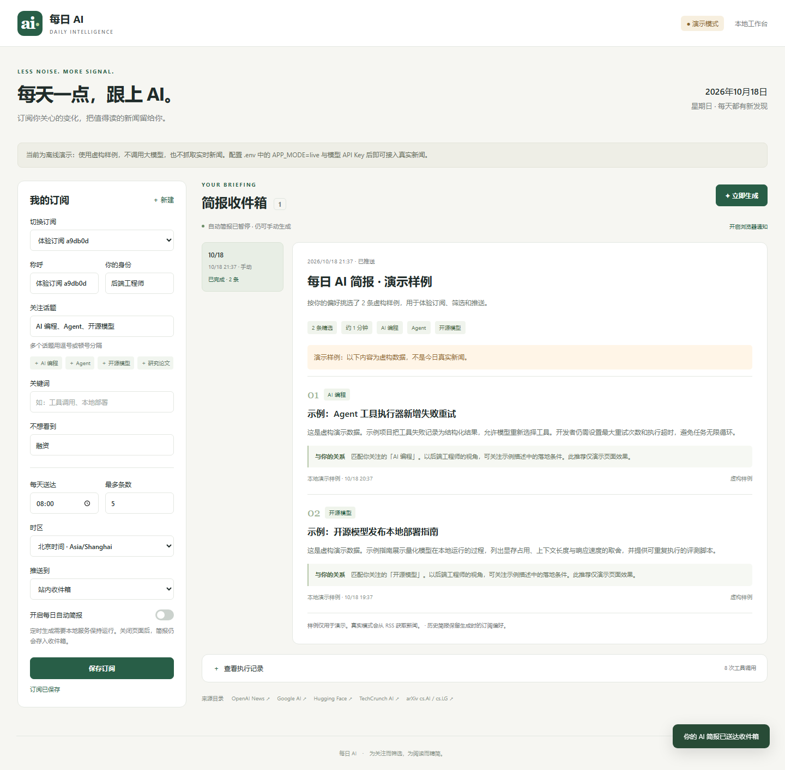
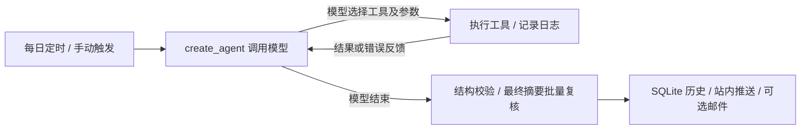

# 每日 AI 新闻助手

一个本地运行的小项目：**Python + LangChain `create_agent` + FastAPI + SQLite + 原生 HTML/JS**。

填写身份、订阅话题与关键词，按用户时区每天生成简报，推送到站内收件箱，也可以配置邮件。每条新闻包含事实摘要、与你的关系、来源和发布时间。



## 直接运行

推荐使用 [uv](https://docs.astral.sh/uv/)。首次运行会安装 Python 3.12 和锁定的依赖。

```powershell
cd <本项目目录>
uv run --locked --no-dev --python 3.12 python -m uvicorn app.main:create_app --factory --host 127.0.0.1 --port 8765
```

Windows 也可以运行 `./run.ps1`，或 `./run.ps1 -Port 8766` 使用其他端口。

打开 <http://127.0.0.1:8765>。接口文档：<http://127.0.0.1:8765/docs>。

若已有 **Python 3.11+**，也可以不用 uv：

```powershell
python -m venv .venv
.venv/Scripts/python -m pip install -r requirements.txt
.venv/Scripts/python -m uvicorn app.main:create_app --factory --host 127.0.0.1 --port 8765
```

macOS / Linux 将 `.venv/Scripts/python` 改为 `.venv/bin/python`。

默认数据保存在项目 `data/` 下，关掉页面不会清空。重启服务后订阅和历史仍保留。

## 演示与真实模式

默认是 **demo 模式**，无需任何密钥。会建立一个暂停自动推送的示例订阅；点击「立即生成」即可体验完整页面和站内推送。

**演示内容是虚构样例，选择逻辑是明确标注的固定演示脚本，不是 LLM 自主决策。** 示例不会混入真实简报，界面、邮件和执行记录均标明模式。演示支持按字面关键词匹配、排除词、历史去重；不会模拟完整语义理解。

启用真实 Agent：

```powershell
Copy-Item .env.example .env
```

在 `.env` 中填写并重启：

```dotenv
APP_MODE=live
OPENAI_API_KEY=你的密钥
OPENAI_BASE_URL=https://api.openai.com/v1
OPENAI_MODEL=gpt-4.1-mini
```

`OPENAI_MODEL` 可换成你有权限使用、支持 function calling 的模型；`OPENAI_BASE_URL` 可换成兼容 Chat Completions 的服务。不同供应商的兼容性需要自行确认。密钥只保留在后端，不传给页面和文件/Shell 工具。

真实模式缺少密钥、模型调用失败或来源全部失败时，任务会明确失败，**不会回退为虚构新闻**。

## 核心：调用顺序由模型决定

真实入口在 [`app/agent.py`](app/agent.py)：

```python
agent = create_agent(model=model, tools=toolbox.tools, system_prompt=SYSTEM_PROMPT)
await agent.ainvoke({"messages": [...]}, config={"recursion_limit": ...})
```

不设置强制 `tool_choice`，不预排业务工具顺序。模型可以先读历史，也可以先取新闻；可以换信息源、补读正文、写研究笔记，接到工具错误后纠正参数，最后调用 `submit_brief` 并结束。



定时、输入校验、输出校验、持久化和推送是普通业务代码；研究阶段的工具选择与结束由模型控制。默认单次 180 秒、最多 24 次工具调用，模型请求最多重试一次，防止失控循环。

所有工具均定义在 [`app/tools.py`](app/tools.py)，可以在页面展开参数、返回值和耗时：

| 工具 | 作用 |
|---|---|
| `list_dir(path)` | 列出本次任务目录 |
| `read_file(path)` | 读取偏好、历史或研究笔记 |
| `search_content(keyword, dir)` | 按字面关键词检索任务目录文本 |
| `write_file(path, content)` | 写入 `scratch/` 下的笔记 |
| `bash(command)` | 真正调用 Bash，支持 `pwd`、`ls`、`cat`、`wc -l`、`head -n` |
| `list_sources()` | 发现可选 RSS 来源和覆盖话题 |
| `fetch_news(source_id)` | 获取某个来源过去 24 小时内容 |
| `read_article(article_id)` | 补读已获取文章的正文 |
| `record_article_states(decisions)` | 批量记录待处理、待阅读、入选、排除，以及理由和原文证据 |
| `submit_brief(title, overview, selections)` | 提交并校验模型筛选的简报 |

文件工具限定在每个用户、每次任务的独立目录。偏好与历史只读，模型只可写 `scratch/`。Bash 使用小型只读命令白名单、路径校验、8 秒超时及精简环境；不提供任意脚本、管道或网络命令。Windows 自动查找 Git Bash，也可以配置 `BASH_EXECUTABLE`。缺少 Bash 时该工具会返回错误，其余工具仍可用。

## 信息来源与筛选

固定接入 5 个 RSS 来源，模型按偏好决定读哪些：

- [OpenAI News](https://openai.com/news/rss.xml)
- [Google AI](https://blog.google/technology/ai/rss/)
- [Hugging Face](https://huggingface.co/blog/feed.xml)
- [TechCrunch AI](https://techcrunch.com/category/artificial-intelligence/feed/)
- [arXiv cs.AI / cs.LG](https://rss.arxiv.org/rss/cs.AI+cs.LG)，研究偏好时使用

代码负责：时间窗口、URL 归一化、重复文章、用户排除词的字面匹配、条数上限、来源 ID 和日期校验。缺少时间的内容不入选；正文获取失败时可以使用有明确标记的 RSS 摘要。

模型负责：跨语言语义相关性、同一事件跨媒体合并、排除话题的语义判断、事实摘要和个性化理由。提交时只接受本次真实获取的文章 ID，标题、链接和时间从来源记录复制。相关性低于 2（直接相关）的候选不允许提交。

最近七天的同模式简报用于去重；新进展应使用新的报道并解释变化。同一 URL 的更新暂不重新推送。没有符合偏好的新内容允许生成空简报；所有尝试的来源失败则不能提交“无新闻”。部分来源失败会保留覆盖范围提示。

arXiv 的 RSS 公告时间只决定是否进入最近 24 小时的候选，不能当作论文首次提交时间。补读摘要页时解析版本记录，分别保存 `announced_at`、`first_published_at` 和 `updated_at`；页面和邮件分别标注「RSS 公告」「首次提交」「修订」，无法确认的时间显示未知。arXiv 的 `/abs/` 页面仅标记为论文摘要，不声称读取了 PDF 全文。

真实模式默认在推送前批量复核最终入选摘要。只发送这几条摘要、日期元数据及每篇最多 5000 字符的原文片段，不重传 Agent 的工具历史或全部候选。复核模型检查数字、分母、实验范围与日期，并返回可在原文精确定位的引用；程序再次检查引用、条目完整性和数值。格式、引用或数值校验失败时允许一次修正请求，不重新研究新闻；明确证据不足或两次校验均失败则任务失败、不推送。每份非空简报通常新增一次模型请求，最多两次，空简报不请求。复核使用同一模型，不能保证消除所有事实错误。

`SUMMARY_REVIEW_ENABLED=true` 默认启用，`SUMMARY_REVIEW_SOURCE_CHARS=5000` 控制原文上限（实际限制在 1000–6000）。复核属于输出校验，研究阶段的工具选择、调用次数和结束仍由 Agent 决定。通过 `scripts.compare_review_usage` 按模型返回的 usage 区分生成与复核成本，包含缓存输入和推理输出，不把 Token 数等同于账单金额。

### 根据筛选状态重建每轮工作材料

`WORKING_CONTEXT_ENABLED=true` 默认启用。新增工具 `record_article_states` 由模型自行调用，给每篇文章记录 `pending`（未决）、`to_read`（待阅读）、`selected`（入选）或 `excluded`（排除），并给出理由。入选项须附 1–3 个连续原文证据片段，程序校验引用确实存在后才接受状态。

每次请求模型前，`app/working_context.py` 使用 LangChain 中间件重建请求中的新闻材料：未决和待阅读文章保留当前完整材料；排除文章只保留 ID、标题、状态及理由；入选文章保留理由、关键证据、来源和独立日期。旧 `fetch_news`、`read_article`、状态工具的正文返回改为简短回执，所有新闻在当轮的一份工作清单中出现。工具调用 ID、调用与结果的配对、错误反馈、用户任务及其他工具记录保留。

这仅修改发给模型的请求，不删除图内原始消息。服务器在 `data/materials/<run_id>.json` 保存来源条目、已读原文和状态，另外保存每轮重建前后的消息字符数；页面的原始工具执行记录仍保留。`read_article` 可重新打开由模型入选或排除的候选，恢复为 `to_read` 并展示完整材料；本次任务已经读过的原文直接复用缓存。本中间件只根据模型状态整理材料；进入候选集之前的确定性检查由下面的预筛选负责。选哪些、何时补读和何时结束仍由 LLM 决定。

字符统计用于检查上下文变化，不等于模型 Token；实际 Token 由真实验收脚本记录 API usage。关闭此开关可保留原追加历史方式用于对照。

实现与验收数据见 [按状态重建上下文验收记录](docs/working-context-acceptance-2026-10-19.md)。

### 来源条目进入模型前的预筛选

`PREFILTER_ENABLED=true` 默认启用，独立于 `WORKING_CONTEXT_ENABLED`。`fetch_news` 在返回模型前去除本轮重复 ID / 规范化 URL、近七天同用户同模式历史中的 ID / URL / 规范化标题，以及标题中明确命中的排除词。英文排除词检查词边界，避免 `AI` 误匹配 `OpenAI`；正文里仅提到排除词的条目仍进入候选。不会用关注关键词做准入白名单，也不推断同义词或语义相关性。

同一 URL 的重复条目只保留首次候选，跨源或重复抓取不覆盖已读正文、日期、阅读状态和模型判断。相同标题但 URL 不同的本轮新闻仍留给模型判断是否为同一事件。有意义的 URL 查询参数保留。时间窗口继续由来源适配器按 `feed_entry_at` / 公告时间处理，预筛选不会用论文首次提交时间再次删除当天公告的 arXiv 论文。最终提交仍校验历史、重复、排除词和时间；其中排除词兜底沿用对标题与正文的检查，比提前的标题检查更严格。

工具回执的 `raw_count` 是本次适配器输出数，`count` 是本次返回给模型的条目数，`prefilter` 包含开关、保留/过滤数及原因计数。重复抓取可能返回零条，但已存在的候选继续保留。成功获取后全部过滤也属于成功覆盖，与来源失败分开。

服务器材料归档新增 `prefilter_batches`：每批的完整原始条目、逐条去留、稳定原因码、命中的排除词或重复对象。`feed_articles` 保留各 ID 的首份摘要，`articles` 仅保存候选及已读材料；过滤项不会进入工作清单，也不能通过 `read_article` 重新打开。原始条目指**来源适配器输出**，不包含已被 RSS 适配器按日期、域名、数量限制等忽略的原始 XML 条目。历史读取沿用每用户最近 100 次任务、其中近七天同模式已有简报的范围；是否邮件投递成功不改变这一已有口径。

冻结数据验收：`uv run --locked --group dev python -m scripts.prefilter_acceptance`。使用同一份来源和历史分别开/关预筛选，并分别开/关工作上下文整理，捕获 SDK 实际发出的 HTTP 消息；模拟服务返回固定工具调用，仅验证协议和筛选材料，不测模型编辑质量、真实 Token 或费用。对照、完整材料归档及复现步骤见 [信息预筛选验收报告](docs/prefilter-acceptance-2026-10-20.md)。

此样品不包含全网搜索、向量数据库或爬虫集群。首次实现将来源目录和筛选过程保持可检查。

## 自动调度与推送

- 在页面开启「每日自动简报」，选择时间和 IANA 时区。
- 后台每 30 秒检查一次；到达当天指定时间后触发。启动晚了会补当天任务，不补发全部历史日期。
- SQLite 的唯一约束保证同一用户、同一天只自动创建一次任务；已有生成任务时不重复排队。
- 同时最多生成 2 份简报；页面显示排队、生成中、完成、失败状态。
- **本地服务需要保持运行。** 不依赖浏览器保持打开，也没有代替你设置系统开机启动。
- 站内推送通过持久化通知 + SSE 实现；页面断开后重连可以补收。浏览器弹窗通知需要用户授权且页面保持打开。
- 邮件失败保留已生成简报和站内通知，可点击「重试推送」，不会重复调用模型。
- 服务重启后，未完成生成标记为中断；发送中的邮件标记为状态未知，先核对收件箱再手动重试。SMTP 不能承诺跨故障的严格 exactly-once。

配置邮件：

```dotenv
SMTP_HOST=smtp.example.com
SMTP_PORT=587
SMTP_USER=你的账号
SMTP_PASSWORD=邮箱应用密码
SMTP_FROM=你的发件地址
SMTP_SECURITY=starttls
```

465 端口通常使用 `SMTP_SECURITY=ssl`。重启后在页面选择「邮件 + 站内收件箱」并填写邮箱。`plain` 仅用于本地 SMTP 测试。

## 项目结构

```text
app/
  main.py          FastAPI 路由、SSE、启动和关闭
  agent.py         create_agent 真实入口与明确隔离的演示入口
  tools.py         10 个工具、调用记录与提交校验
  prefilter.py     来源条目的确定性去重、历史和标题排除检查
  working_context.py 按状态重建每轮模型请求的新闻工作材料
  sources.py       RSS、正文提取、离线样例
  article_time.py  首次发布、修订与 RSS 公告的独立时间口径
  summary_review.py 最终摘要的批量事实复核与引用校验
  service.py       调度、任务状态、超时、推送协调
  storage.py       SQLite 数据与并发约束
  delivery.py      邮件文本/HTML 和 SMTP
  schemas.py       订阅、简报字段校验
  config.py        环境变量配置
  static/          无构建依赖的前端
tests/             工具、Agent、API、调度、邮件测试
scripts/           来源连通性和浏览器验收脚本
docs/              桌面和手机截图、验收记录
```

## 验证

```powershell
uv sync --locked
uv run --locked --group dev python -m pytest -q
uv run ruff check app tests scripts
uv run ruff format --check app tests scripts
uv run python -m scripts.check_sources
uv run --locked --group dev python -m scripts.prefilter_acceptance
```

浏览器验收（先运行 demo 服务，会新建一个测试订阅）：

```powershell
uv run python -m playwright install chromium
uv run python -m scripts.browser_smoke --url http://127.0.0.1:8765
```

测试中的模型使用模拟 HTTP 服务，**实际执行 `ChatOpenAI` → `create_agent` → 工具 → 模型返回**的完整协议；验证两种不同工具顺序、错误反馈与模型结束行为。SMTP 使用本地收件服务器，不向真实邮箱发信。

基础验收见 [`docs/verification.md`](docs/verification.md)。真实模型修复复测与 Token 对比见 [`docs/review-fixes-acceptance-2026-10-19.md`](docs/review-fixes-acceptance-2026-10-19.md)。

预筛选与上下文整理的真实模型消耗对照见 [2026-10-20 Token 验收](docs/token-acceptance-2026-10-20.md)：三组使用同一份冻结真实新闻和历史，按 API usage 区分生成、复核、缓存和推理用量。联合方案的生成 Token 下降，但复核失败，端到端验收未通过；仅开启上下文整理的一次运行总 Token 增加。结果保留全部失败消耗，不把消息字符缩减当作实际 Token 节省。

真实验收会使用 `.env` 的模型配置、实际联网取新闻，并推送到独立测试收件箱：

```powershell
uv run python -m scripts.live_acceptance --scenarios 3
uv run python -m scripts.compare_review_usage docs/live-acceptance-时间戳.json --output docs/review-usage.json
uv run python -m scripts.review_regression --captured docs/live-acceptance-20261019T053745Z.json --output docs/review-regression.json
```

## 样品边界

这是单机、单服务进程样品，默认只监听 `127.0.0.1`，没有登录鉴权；页面的多份订阅是本地配置档案，不是安全隔离的互联网账号。请用一个 Uvicorn worker。要公开部署，应先补登录、数据权限、独立调度进程和运行监控。

模型摘要仍可能出错；保留原文是为了便于核对。站内不显示模型内部思维链，只显示可核查的工具调用。少量 RSS 在周末没有更新属于正常情况，来源检查脚本会区分空内容与连接失败。

实现依据：[LangChain create_agent](https://docs.langchain.com/oss/python/langchain/agents)、[LangChain 请求中间件](https://reference.langchain.com/python/langchain/agents/middleware/types/AgentMiddleware/wrap_model_call)、[ModelRequest.override](https://reference.langchain.com/python/langchain/agents/middleware/types/ModelRequest/override)、[OpenAI function calling](https://developers.openai.com/api/docs/guides/function-calling)、[FastAPI](https://fastapi.tiangolo.com/)、[arXiv RSS](https://info.arxiv.org/help/rss.html)。
